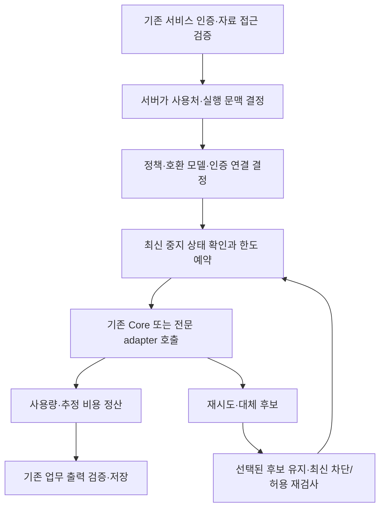

# O4O AI 사용처 설정·공통 호출 제어 설계

> **상태**: DRAFT — 설계 산출물; 애플리케이션 미구현·운영 미적용
> **작성일**: 2026-10-20 · **최종 갱신**: 2026-10-20 (Asia/Seoul)
> **근거 WO/IR**: 사용자 요청 「사용처별 설정 항목과 공통 호출 제어 설계 진행, push까지」 · [사용처 조사표][inventory]

- 기준 코드: `d176026c24852870dc57713dd09623b0cebb4c68` (`origin/main`, PR #720 병합 시점)
- 조사 의존성: [PR #721][inventory-pr]의 조사 문서는 작성 시점 main 미반영. 고정 커밋 링크로 참조하며 이 branch에 복사하거나 병합하지 않음
- 조사 기준 `b54074d038` 이후 위 main까지 변경은 공급자 사업자명 관련이며 AI 경로 변경 없음
- 이번 변경: 이 설계 문서 1개. 새 API·UI·DB schema·인증·설정·과금 변경 없음
- 종료점: 검증 → commit → **push** → 인계. PR 생성·병합·배포 미수행
- DEPLOYMENT = **NOT_APPLICABLE** (문서만 변경)

## 1. 목표와 설계 경계

관리자는 서비스·기능을 이름으로 고르고, 사용할 API 공급자·호환 모델·사용 여부를 설정한다. 해당 기능의 실제 실행에서 그 설정을 확인하고, 사용량·추정 비용과 적용 상태를 확인할 수 있어야 한다.

기존 [AI Core/Extension 정본][foundation]의 실행·정책·한도 예약·정산을 확장한다. Core는 DB·키·업무 권한을 직접 소유하지 않고 API 서버가 조립한다. 모델 선택을 업무 Extension의 prompt나 개별 화면에 하드코딩하지 않는다.

범위는 플랫폼 전체 AI 설정과 집계다. 서비스별 가입·승인·콘텐츠·거래 업무는 기존 서비스가 책임진다. 관리자에게 개별 이용자의 상담 본문·사용 행적을 추적하는 화면을 추가하지 않는다. 외부 개인 ChatGPT 등의 사용량도 O4O API 비용과 합치지 않는다.

현재 지원된 플랫폼 부담 체계를 유지한다. 사용자/매장에 비용을 청구하거나 외부 개인 계정으로 자동 전환하는 정책을 추가하지 않는다. 유료 음성 도입·DeepSeek 실제 연결·새 데이터 전송 범위는 각각 후속 구현 대상이다. 제거한 동영상 제작·사이니지·AppStore 메뉴와 미사용 기능을 복구하지 않는다.

## 2. 재사용할 구조와 현재 한계

| 기존 구조·근거 | 재사용 방식 | 후속 구현에서 보완할 점 |
| --- | --- | --- |
| [서비스 카탈로그][services] | 서비스 이름·canonical identity의 출처 | 호스트·약국 사업명·legacy quota 이름으로 새 serviceKey를 만들지 않음 |
| [AiLlmPolicy][policy-entity], [정책 실행기][policy] | 모델·provider·중지·명시적 fallback 선택의 기준으로 확장 | 현재 scope 유일키이므로 기능별 override, 버전, 충돌 방지 저장에 필요한 schema/API 검토 필요 |
| [AiQueryPolicy][query-policy], [기존 UI][settings] | 공통 질의의 일일 제한·시스템 지침과 기존 동작 승계 | 기존 `aiEnabled`를 전역 중지라고 표시하지 않음. 이관된 기능에 대한 구/신 설정의 중복 쓰기 제거 |
| [회계 실행][accounting], [quota][quota] | 사전 예약·정산·실패/불명 사용량 처리 재사용 | 직접 HTTP·멀티모달·음성 adapter 연결, 개별 시도 식별·중지 재검사 필요 |
| [usage log][usage], [aggregate][aggregate], 예약 receipt | 실행·추정 비용의 기존 원장과 연결 ID 승계 | 서비스·기능·정책 버전·단위·시도별 차원 및 provider 지원 집합 확장 검토 |
| [키 resolver][keys], [runtime][runtime], [모델 registry][models] | 비공개 인증 연결과 실제 호출·모델 검증 재사용 | 조회 경로 정합, provider별 capability, 키 연결과 중지 분리 |
| [관리 API][admin-api], [requireAdmin][admin-guard] | 관리자 인증·집계·운영 설정 경로 확장 | 최신 DB 역할 판정 유지, 오류를 0으로 표시하는 경로 정비 |

별도 AI 실행기·새 비용 원장·새 Memory·새 인증 체계를 만들지 않는다. 기존 구조 확장에 필요한 migration은 후속 WO에서 변경 전후·호환·backfill·rollback을 명시한다. 이 설계로 운영 DB 변경이 실행되거나 승인된 것으로 보지 않는다.

## 3. 설정 대상과 서비스 귀속

### 3.1 서비스·기능의 출처

- 서비스 선택지는 기존 카탈로그에서 얻는다. 퇴역 서비스는 신규 설정 대상으로 노출하지 않는다.
- 기능 목록은 서버가 관리하는 등록 정보로 제공한다. 관리자/클라이언트가 문자열이나 endpoint를 입력해 호출 기능을 만들 수 없다.
- 기존 Extension의 `featureId`/`extensionId`는 유지한다. 미연결 경로에 필요한 ID는 호출부와 함께 등록하고 조사 ID `A01` 등을 근거로 연결한다. 조사 번호 자체를 영구 실행 키로 쓰지 않는다.
- 실행 요청의 서비스·사용자·조직·audience는 기존 서버 권한 검증으로 확정한다. 드롭다운 선택이나 클라이언트의 serviceId로 자료 접근·부담 주체를 바꾸지 않는다.
- `store`, `proxy` 같은 현재 회계 scope의 legacy 매핑은 canonical 서비스 목록과 별개다. 기존 귀속을 임의로 바꾸거나 과거 집계를 재배분하지 않는다.
- 공개 병원약국 도구와 플랫폼 공통 상품 DB처럼 귀속이 단순하지 않은 사용처는 이름으로 식별하되, canonical 서비스/기존 회계 대상의 명시적 연결을 확인하기 전에는 새 정책 실행을 활성화하지 않는다. 임의로 Neture에 귀속시키지 않는다.
- CarePharm/MegaPharm 등 사업 구분은 필요한 경우 기존 사업 문맥으로 표시한다. 해당 이름의 독립 canonical serviceKey가 있다고 추정하지 않는다.

### 3.2 조사 사용처를 설정 항목으로 연결하는 초기 목록

아래는 **등록 후보**다. 소스 존재가 운영 사용을 뜻하지 않으며, 실제 소비처와 귀속 확인 후 활성 대상에 포함한다. 공통 기능은 서버가 검증한 서비스 문맥별 설정을 지원한다.

| 조사 ID | 관리자 표시 기능 | 요구 능력·설정 분리 | 기존 연결/전환 주의 |
| --- | --- | --- | --- |
| A01 | 공통 질문·요약 | 텍스트; 현재 요청 kind는 보존 | `SERVICE_QUERY`, 기존 질의 제한 유지 |
| A02 | 홈 대화 | 텍스트 | runtime 선택을 기능 정책으로 연결 |
| A03 | 홈 첨부 해석 | 이미지·PDF 입력 | 지원되지 않는 첨부를 몰래 제거하거나 텍스트 모델로 전환하지 않음 |
| A04 | 웹 조사 | 검색 근거/grounding | 단순 텍스트 모델과 구분 |
| A05 | 병원약국 공개 조사 | grounding, 비로그인 | 공개 주체·귀속·기존 요청 제한 확인 |
| A06 | 첨부 구조 추론 | 텍스트 구조화 | 파싱만 한 작업은 AI 호출로 계수하지 않음 |
| A07 | 병원약국 공개 구조 추론 | 구조화, 비로그인 | 공개 경로의 귀속·예산 연결 확인 |
| A08 | 업무 계획·복구 | 일반/strong 역할별 모델 | 역할별 선택값을 구분하고 업무 실행 구조 유지 |
| A09 | 업무 화면 판독 | vision | A08의 텍스트 모델과 별도 호환성 검사 |
| A10 | Assistant 이해·완료 판정 | 텍스트, 단계 식별 | 기존 Task/Planner 구조·개발 순서 보존 |
| A11 | 편집 콘텐츠 생성 | 출력 종류별 구조화 | 현재 Gemini/Qwen guardrail·출력 schema 유지 |
| A12 | URL의 편집 블록 변환 | 구조화 | URL 읽기와 유료 생성 호출 구분 |
| A13 | 콘텐츠 매장 활용 변환 | 출력 종류별 구조화 | A11과 공통 실행 재사용, 실제 출력 종류 기록 |
| A14 | 강의 구조 생성 | 구조화 | 구조 출력 계약 보존 |
| A15 | 강의 본문 생성 | 텍스트/기존 출력 계약 | A14와 독립 기능 선택 |
| A16 | 이미지 분석 | vision | 직접 HTTP를 회계·중지 관리에 연결 |
| A17 | 관리자 블록 생성 | 기존 블록 schema | client의 provider/model 값은 서버 정책을 우회하지 못함 |
| A18 | 상품 태그 생성·제안 | 구조화 | `PRODUCT_TAGGING` 선언과 실제 연결 구분 |
| A19 | 전역 상품 콘텐츠 생성 | 콘텐츠 종류별 구조화 | `PRODUCT_CONTENT`; 인증 actor 전달 누락 보완 |
| A20 | 매장 콘텐츠 번역 | 텍스트/구조화 | `CONTENT_TRANSLATION`의 콘텐츠 기능 override |
| A21 | 약국 상담 번역 | 텍스트/구조화, 수치 보존 | 같은 scope의 상담 기능 override; 기존 검증·접근권한 유지 |
| A22 | 운영 선택 목록 요약 | 텍스트 | KPA 실제 소비처 유지 |
| A23 | 운영 콘텐츠 요약 | 기존 출력 계약 | 기존 규칙 대체 결과와 AI 성공 구분 |
| A24 | 운영 콘텐츠 추출 | 구조화 | A23과 기능별 식별 |
| A25 | 운영 콘텐츠 태그 | 구조화 | 상품 태그 A18과 구분 |
| A26 | 퀴즈 답안 분석 | 구조화 | `LMS_ASSISTANCE`, 성적 수정 없음 |
| A27 | 제출 과제 피드백 | 구조화 | A26과 실행 공유, 기능은 구분 |
| A28 | 운영 인사이트 | 구조화 | `OPERATOR_INSIGHT`; 기존 서비스/actor 유지 |
| A29 | 운영 추천 행동 | 구조화 | `OPERATOR_ACTIONS`; 추천과 실제 업무 실행 구분 |
| A30 | 공급자 HUB AI 갱신 | 기존 insight 출력 | 화면 route·POST 소비 코드는 조사표에서 확인; 실제 운영 이용·현행 사업 적합성 확인 전 관리 활성으로 표시하지 않음 |
| A31 | 음성 합성 | TTS, 출력 형식·음성 | 잔존 API의 필요 여부 확인; 삭제된 영상 UI 복구 안 함 |

유료 음성 인식(STT)은 도입 예정 항목으로 별도 표시한다. STT → 번역 → 음성 합성을 연결하면 작업 1건 아래 각 단계가 별도 유료 호출로 기록된다. 브라우저 SpeechRecognition/speechSynthesis는 서버의 유료 API 통계에 포함하지 않는다. 미사용 Store insight, 규칙 기반 Forum, DB 검색/추천, 개발 smoke 스크립트도 운영 유료 사용처와 구분한다.

조사표 보완에서 X01 상품 이미지 OCR(Google Cloud Vision TEXT_DETECTION)도 확인했다. 기존 두 업로드 handler의 자동 호출은 생성형 모델 선택과 별개이며 현재 모델 관리에 연결돼 있지 않다. 후속 catalog는 이 전문 API의 사용 여부·이미지/기능 단위·인증 준비 상태를 별도 등록하고 공통 중지/집계 연결을 검토한다. 고정 기능 API에 지원하지 않는 모델 dropdown을 만들거나 OCR 본문을 새 비용 원장에 복제하지 않는다.

## 4. 관리자 설정 항목

| 항목 | 입력·표시 방식 | 서버 검증·규칙 |
| --- | --- | --- |
| 대상 서비스·기능 | 이름으로 검색/드롭다운 선택 | 서버 등록 대상과 검증된 서비스 연결만 허용 |
| 사용 여부 | 사용/중지 | 중지는 아래 공통 제어를 경유한 실제 실행에 적용 |
| API 공급자 | 지원 공급자 선택 | 연결 구현·자료 전송 범위·기능 guardrail을 통과한 후보만 |
| 모델 | 이름·능력·제공 상태로 선택 | 유효 ID, 구조 출력/vision/grounding/음성 등 해당 기능의 필수 능력 검증 |
| 인증 연결 | 등록된 연결 이름 선택·상태 표시 | 비공개 reference만 전달. 원문 키 조회/입력 필드를 기능 설정에 만들지 않음 |
| 설정 상속 | 공통 기본값 사용/이 기능에서 지정 | 어떤 기본값을 상속하는지 표시; 명시적 중지를 상속으로 해제하지 않음 |
| 장애 시 대체 | 기본은 추가 후보 없음; 필요 시 허용 후보 지정 | 능력·자료 전송·부담·가격·한도·중지 검사를 모두 통과한 후보만 호출 |
| 제한 | 기존 제한/예약 정책과 연결해 표시 | 새로운 금액·요금제·고객 청구는 이 설계에서 정하지 않음 |
| 적용 상태 | 저장/적용 버전, 상태·시각·근거 표시 | 저장 성공과 실행 적용 확인을 구분 |
| 집계 연결 | 연결/부분 연결/미연결 | 실행 중지나 연결 오류와 별도 축으로 표시 |

provider별 “이름이 알려져 있음 / transport 구현 / 기능 호환 / 인증 연결 / 가격 구성 / 운영 적용”을 구분한다. Gemini 목록 조회를 OpenAI·Claude·Qwen·DeepSeek에도 적용되는 검증이라고 취급하지 않는다. 목록 조회 성공만으로 기능 호환·호출 성공을 보장하지 않는다. 목록/인증 상태 확인은 생성 smoke와 분리하고 자동 유료 호출을 하지 않는다.

새 모델의 공식 제공 여부·실제 연결·가격 단위는 공급자 근거로 검증한 뒤 선택 가능하게 한다. 기존 코드 상수를 무조건 현행 추천 모델로 표시하지 않는다. DeepSeek의 실제 사용 위치/adapter가 확인되기 전에는 “도입 확인 필요”로 표시하며 기존 Qwen 제한을 우회하지 않는다.

## 5. 정책 우선순위·저장·기존 설정 호환

### 5.1 호출 허용과 모델 결정

중지 판정은 모델 상속보다 먼저 수행한다. **플랫폼 전체 중지 → 해당 서비스 중지 → 해당 기능 중지 → 공급자 연결 중지** 중 하나라도 적용되면 유료 호출 admission을 거부한다. 하위 설정의 “사용”으로 상위 중지를 해제하지 않는다. 이 설계의 서비스 중지는 AI 사용만 제어하며 서비스 가입·접근 자격은 바꾸지 않는다.

호출이 허용되면 **기능별 명시 설정 → 서비스의 해당 능력 기본값 → 플랫폼의 해당 능력 기본값** 순으로 모델을 결정한다. 능력이 다른 기능끼리 하나의 기본 모델을 강제하지 않는다. Extension/audience/일반·strong 등 실행 프로필의 제약도 함께 검사한다.

- 값이 없는 상속과 의도적인 중지를 구분한다. 없는 정책을 임의의 활성 Gemini 설정으로 생성하지 않는다.
- 조회 실패·잘못된 연결·비호환 모델·기능 미등록은 관리 대상 경로에서 외부 호출 전 오류로 종료한다. 장애를 다른 provider나 환경 키로 우회하지 않는다.
- 환경변수는 등록된 비공개 인증 연결의 원천일 수 있지만, 기능 중지를 풀거나 기능 정책의 모델을 덮어쓰는 경로가 되어서는 안 된다.
- 클라이언트의 provider/model은 이관 후 서버 선택의 권한이 아니다. 기존 요청 형태는 유지할 수 있으나 적용 여부를 검증해 명시적으로 알리고 조용한 모델 대체를 하지 않는다.

### 5.2 단일 설정 원천과 동시 수정

기능별 모델 정책은 기존 `AiLlmPolicy` 계층을 확장하는 방향으로 둔다. 현재 scope 유일키만으로 필요한 서비스·기능·Extension·audience별 선택을 표현할 수 없으므로 후속 구현에서 additive 키/override와 정책 버전을 설계한다. 기존 scope의 한도·과거 비용 귀속을 새 기능 키로 무작정 치환하지 않는다.

A20/A21은 기존 `CONTENT_TRANSLATION`을 기본으로 상속하되, 콘텐츠/상담 override를 독립 저장한다. 둘을 구분하기 위해 동일 설정을 두 저장소에 복제하지 않는다. 기존 기능에 ID/Extension 문맥이 없으면 먼저 서버에서 확인 가능한 연결을 만든다.

저장은 현재 버전을 포함한 조건부 갱신으로 수행한다. 다른 관리자 저장과 충돌하면 덮어쓰지 않고 새 값과 함께 다시 확인하게 한다. 후보 검증·새 버전 저장은 일관된 단위로 처리하며 검증 실패 시 기존 설정을 유지한다. API는 기대 상태와 현재 적용 증거를 따로 반환한다.

유효 정책 버전은 선택한 기능 행뿐 아니라 상속한 서비스/플랫폼 기본값과 제약의 버전도 식별해야 한다. 기본값 변경이 기능 행의 수정 없이 발생해도 적용 비교에서 감지한다. 저장/적용/실행 기록은 같은 유효 버전 표현을 사용하고 중지 판정은 최신 공유 상태에서 따로 확인한다.

설정 변경에 필요한 최소 정보(설정 버전·변경 주체의 내부 참조·시각·비밀값 없는 변경 요약)는 기존 메타/감사 경로를 사용한다. 별도 운영자 교체 추적 업무나 복잡한 이력 관리 메뉴를 만들지 않는다. 과거 버전으로 복원할 때도 새 버전으로 저장하고 현재 호환성·중지·연결 상태를 재검증한다.

### 5.3 기존 Q 설정과 엔진 활성화

- 미이관 기능은 기존 설정을 사용하되 “기존 경로/부분 연결”로 표시한다. 새 공통 제어가 적용된 것처럼 표시하지 않는다.
- 이관 기능에는 구 Q 설정·엔진 활성화가 별도 모델 원천으로 계속 쓰이지 않게 한다. 관련 기존 쓰기 API는 범위가 같은 새 설정으로 연결하거나 해당 기능에 대한 수정 불가를 명확히 반환한다. 읽기 client·base URL·에러 계약을 함께 검증한다.
- 기존 공통 질의 일일 제한·시스템 지침은 보존한다. 기능 설정 화면에 중복 시스템 prompt 편집기를 만들지 않는다.
- 이관 전 현재 선택값·귀속·한도를 확인해 초기 정책을 명시적으로 구성한다. 새 기본값을 이유로 운영 모델·부담·중지 상태를 일괄 변경하지 않는다.

## 6. 공통 호출 제어와 중지의 정확한 의미

이는 **목표 흐름**이며 새 provider stack을 만들라는 지시가 아니다. 기존 `AiAccountedExecution`과 Core 호출을 감싸거나 확장하고, 멀티모달/grounding/TTS는 능력을 유지한 전문 adapter로 같은 제어·정산 경계를 거치게 한다.

도식의 예약은 기존 invocation 예산을 재사용한다. 재시도 admission 때마다 전체 예산을 중복 예약하지 않고 기존 예약에서 허용된 시도와 잔여량을 검증한다. 처음 선택한 primary/fallback의 모델·가격 snapshot은 invocation 동안 유지하며, 새로운 기본 모델은 다음 invocation부터 적용한다.

중지는 다음 의미로 검증한다.

1. 중지 저장 이후 **새 admission**은 거부한다. admission은 외부 유료 시도 전에 최신 공유 정책에서 허용을 확정하는 경계다. 모든 인스턴스가 같은 원천을 보고 중지/버전을 재검사하며, 허용 여부를 기존 60초 모델 캐시만으로 판정하지 않는다.
2. 중지 직전 이미 admission된 요청은 진행될 수 있다. 저장과 실제 HTTP 전송 사이의 경쟁 및 이미 공급자에게 전달된 요청을 표시·기록하며 취소/비용 환불을 보장하지 않는다. 전송 직전 가능한 재검사와 미사용 예약 해제를 구현에서 검증한다.
3. 같은 Work Agent 작업의 다음 단계, retry, fallback도 각각 새 admission을 받는다. Core 내부 자동 retry와 직접 HTTP 내부 retry까지 포함한다. 최상위 route에서 한 번 확인하는 것으로 완료하지 않는다.
4. 중지·정책 조회 실패·한도 부족은 다른 모델/키로 유료 전환할 이유가 아니다. 기존 순수 규칙 대체는 가능하되 외부 AI 결과로 표시하지 않는다. 중지 상태에서 AI 캐시 결과를 제공한다면 기존 결과임을 표시하고 유료 재생성을 하지 않는다.
5. 전체 중지의 완료 표시는 현재 서빙 revision의 모든 유료 transport가 제어 경계에 연결됐는지 확인한 뒤 제공한다. 미이관 경로가 있으면 영향 범위와 “부분 적용/미연결”을 표시한다.

공개 도구는 비로그인 주체를 명시하며 가짜 사용자 UUID를 만들지 않는다. 기존 IP/rate 제한을 유지하면서 서비스/기능 예산에 연결한다. 공개 요청의 IP를 새 AI 비용 원장에 무조건 저장하지 않는다.

오류는 중지, 미설정, 비호환, 정책 조회 실패, 한도 초과, provider 실패, 적용 확인 불가를 구분한다. 생성 성공 후 출력 검증/DB 저장이 실패해도 이미 발생한 AI 비용은 유지한다. 정산 장애는 기존처럼 미해결 예약/경고로 남기며 유료 재호출하거나 TTL만으로 해제하지 않는다.

## 7. 사용량·비용과 적용 상태

### 7.1 기록과 합산

기존 usage/예약 receipt의 additive 확장으로 아래 정보를 연결한다. 모든 값을 하나의 신규 원장에 복제하지 않으며 영속화 위치와 migration은 후속 구현에서 명시한다.

| 기록 묶음 | 필요한 정보 | 집계 규칙 |
| --- | --- | --- |
| 업무 문맥 | 검증된 서비스·기능·Extension/audience, 업무 request/task 연결 | 업무 1건과 유료 호출 건수 별도 |
| 실제 시도 | invocation·attempt·provider request 연결, 실제 provider/model, retry/fallback 사유 | 성공/실패/사용량 불명 시도를 식별. 실제 공급자 ID가 없는 timeout도 내부 ID로 기록 |
| 적용 근거 | 사용한 정책/가격 버전, 실행 revision/adapter, admission 시각 | 설정 저장 버전과 실제 실행 버전을 비교 |
| 사용량 | 입력/출력 토큰, 음성 길이·문자·tool 등 공급자가 제공한 해당 단위, 응답 지연 | 서로 다른 단위를 한 숫자로 합산하지 않음. `durationMs`를 음성 길이로 사용하지 않음 |
| 비용 | 실제 사용량에 따른 추정액, 통화·단가 버전·추정/불명 여부 | 현재 USD 한도 체계를 유지. 청구 금액과 구분 |
| 정산 | 기존 예약·정산·미해결 상태와 연결 ID | 한 invocation의 예약/정산을 중복 계수하지 않음 |

현재 회계 wrapper는 invocation 단위 결과/불명 시도 예산을 처리한다. 시도별 관측을 위해 Core/provider adapter 내부 hook이 필요하며 현행 `AIUsageLog` 한 행이 이미 모든 물리 호출을 나타낸다고 가정하지 않는다. 계층 양쪽이 같은 시도를 중복 기록하지 않도록 내부 시도 ID로 멱등 처리한다. 공급자 성공과 업무 출력 검증 성공도 구분한다.

가격/사용량을 확인하지 못한 신규 능력을 0원으로 처리하지 않는다. 검증된 단가·예산 예약 방법이 준비된 기능부터 유료 실행에 연결한다. 특히 이미지/grounding/음성은 텍스트 토큰 추정만으로 비용 상한을 보장하지 않는다. 기존 미해결 예약 reconcile 절차를 승계한다.

과거 기록의 서비스·기능 정보가 없으면 “기능 미분류/집계 부분 연결”로 남긴다. 존재하지 않는 과거 사용량을 backfill로 만들어 전체 비용처럼 표시하지 않는다. 기존 aggregate가 한도 카운터인 경우 실제 호출 수 통계와 혼용하지 않는다. 일별·월별 경계는 Asia/Seoul 기준으로 명시하고 기존 quota 기간 키와 다르면 영향 분석 후 이관한다.

### 7.2 상태 표시

| 축 | 표시 상태 | 근거 |
| --- | --- | --- |
| 사용처 확인 | 등록 후보 / 소비처 확인 / 미사용·미연결 / 도입 예정 | route·client·업무 사용 확인 결과 |
| 설정 | 사용 / 중지 / 미설정 | 저장된 유효 정책 |
| 적용 | 적용 대기 / 적용 확인 / 부분 적용 / 확인 불가 | 목표 버전, 현재 서빙 코드의 제어 지원, 최신 admission의 버전 관측·검증 결과 |
| 집계 | 연결 / 부분 연결 / 미연결 / 조회 실패 | 해당 transport의 연결 범위와 기록·조회 결과 |
| 공급자 연결 | 준비 / 미설정 / 오류 / 미확인 | 인증 연결과 지원 상태; 유료 생성 성공을 뜻하지 않음 |

호출이 없어 실행 버전이 관측되지 않은 기능을 “실제 호출 검증 완료”로 표시하지 않는다. 한 인스턴스의 성공만으로 전체 적용을 확정하지 않고 현재 서빙 revision/전문 adapter의 지원 범위를 함께 확인한다. 목표 버전보다 이전 버전이 보이면 부분 적용으로 표시한다. 조회가 실패하면 마지막 확인 시각과 오류를 표시하며 0/사용 중/적용 완료로 대체하지 않는다.

정상 모델 변경은 새 invocation부터 적용한다. invocation에 고정한 모델·가격 snapshot을 중간에 조용히 바꾸지 않는다. 단, 중지와 연결 차단은 매 시도 재검사한다. 새 정책이 fallback/자료 전송 허용을 회수했으면 그 후보도 다음 admission에서 거부한다.

### 7.3 개인정보와 조회 권한

[기존 보유기간 정본][retention]을 따른다. AI usage에는 입력·응답·첨부 원문·음성·키·외부 오류 원문을 새로 저장하지 않는다. 필요한 actor/조직 연결은 기존 서버 문맥에서 얻되 관리자 기본 화면은 서비스/기능 단위 집계로 제공한다. 익명 원문 수집·개별 사용 행동 추적은 범위 밖이다.

기존 `authenticate`/`requireAdmin`의 플랫폼 관리자 DB 역할 판정을 사용한다. 서비스 admin/operator나 클라이언트가 보낸 role로 전체 설정·통계를 열지 않는다. 별도 권한 체계나 서비스 업무 개입 권한을 추가하지 않는다.

## 8. 관리자 초기 화면과 API 작업 범위

관리자 메뉴는 **AI 운영 관리** 하나를 두고 세 탭으로 구성한다. 초기 화면은 사용처 설정이다. 기존 AI Query 화면은 영향 안내/동일 설정 경로로 연결하고 서로 다른 전역 모델 선택 화면을 병렬로 남기지 않는다. 현재 route와 하위 client를 조사한 뒤 이관하며 메뉴만 먼저 바꾸지 않는다.

| 탭 | 초기 배치 | 주요 동작·상태 |
| --- | --- | --- |
| 사용처 설정 | 상단 서비스·기능·상태 필터, 본문 서비스/기능·현재 API/모델·설정·적용·집계 표 | 항목 선택 → 상세 panel의 공급자/모델/인증 연결 선택·상속·사용 여부. 변경 영향 기능을 저장 전에 표시 |
| API·모델 연결 | 공급자별 연결 상태와 호환 모델 표 | 비공개 연결 이름/준비 상태, 능력·목록 출처/조회 시각·검증 상태. 키 원문 노출 없음 |
| 사용량·비용 | 기간 선택, 호출/실패/추정 비용 합계, 서비스·기능·모델별 표 | 업무 수/유료 시도 수, 단위별 사용량, 일부 집계/미분류/조회 오류 표시. 차트는 표와 동일 집계 사용 |

빈 목록, 미연결, 도입 예정, 조회 오류를 각각 설명한다. 선택 가능한 공급자/모델이 없으면 이유를 표시한다. 메뉴에 빈 기능이나 미지원 모델을 사용 가능하게 노출하지 않는다. 변경 저장은 필요한 영향 확인을 포함하되 불필요한 다단계 승인 절차를 만들지 않는다.

API는 기존 `/api/ai/admin` 아래 등록 목록 조회, capability/연결 목록 조회, 기능별 유효 정책 조회·조건부 수정, 적용 상태, 서비스/기능별 집계를 확장한다. 정확한 endpoint/DTO는 후속 구현 WO에서 기존 route/client와 중복 여부를 확정한다. 모델/키를 임의 URL로 전달하거나 client에서 provider를 직접 호출하는 API를 만들지 않는다. 관리자 UI는 `/api`와 `/api/v1` base 차이를 검증한다.

## 9. 실행 TODO·순서·완료 기준

이번 산출물과 후속 구현을 구분한다. 구현 TODO의 체크는 소스 또는 운영 검증 증거가 생긴 뒤 갱신한다.

- [x] 최신 main과 조사표 비교, 정본/기존 구조 재확인
- [x] 사용처별 등록 후보·설정 항목·기능 공유 해소 방향 작성
- [x] 정책 우선순위·중지·재시도·fallback·집계·적용 상태 계약 작성
- [x] 관리자 초기 화면과 후속 구현 검증 기준 작성
- [ ] 기능 등록/귀속과 기존 설정값·활성 소비처 확인
- [ ] 기존 정책 계층 확장·동시 수정 제어·기존 쓰기 API 호환 구현
- [ ] 실제 호출의 중지/한도/시도별 집계 연결
- [ ] 세 탭 UI와 설정 적용/집계 오류 표시 구현
- [ ] mock·격리 DB·소비 화면 회귀 검증
- [ ] 승인된 범위의 운영 설정/공급자 청구 대조·배포 검증

| 단계 | 구현 묶음 | 먼저 끝낼 기준 |
| --- | --- | --- |
| 1 | 등록 목록·읽기 API·귀속과 현재 설정 확인 | 31개 조사 행 각각의 활성/미연결/미사용 판정 근거. 새 모델 선택/유료 호출을 자동 활성화하지 않음 |
| 2 | 정책/제어·기존 연결 기능부터 적용 | A01/A19~A21 등 기존 경로의 정책·actor·공유 scope 보완과 구/신 writer 정합. 현재 선택값 보존 |
| 3 | 직접 호출 이관 | 실제 사용하는 홈/공개 도구/Work Agent 등 미연결 경로 우선. 사용량이 많다고 추정해 순서를 정하지 않으며 실제 소비처 확인 후 결정 |
| 4 | 관리자 변경·사용량 화면 | 지원하는 항목만 변경 가능. 전체 중지/적용/비용 합계의 연결 범위를 과장하지 않음 |
| 5 | 신규 능력·운영 대조 | DeepSeek 위치/연결 확인, 유료 STT 등은 별도 adapter·자료/단가 검증 후 도입 |

### 검증 시나리오

| 검증 | 기대 결과 |
| --- | --- |
| V01 기능별 모델 변경 | 다른 기능은 유지, 새 요청의 실제 target·usage가 저장 정책 버전과 일치 |
| V02 전체/서비스/기능 중지 | 각 범위의 새 admission 거부. 하위 사용 설정·환경 키로 우회 불가 |
| V03 작업 도중 중지 | 이미 admission된 시도와 이후 단계 구분. retry/fallback/strong 복구의 새 유료 시도 거부 |
| V04 멀티 인스턴스·이전 revision | 캐시가 남은 인스턴스의 새 admission도 최신 중지 확인. 미지원 서빙 코드 존재 시 부분 적용 표시 |
| V05 정책/연결/가격 DB 오류 | provider 호출 전 거부. 빈 정책 자동 활성화·환경 모델 대체 없음 |
| V06 비호환 모델 | vision/grounding/구조화/음성 등 요구가 맞지 않으면 저장/실행 거부. 첨부를 몰래 버리지 않음 |
| V07 번역 정책 분리 | 상담만 override/중지해도 콘텐츠 번역 기본 설정 보존. 수치 보존·소유권 검증 유지 |
| V08 동시 저장·복원 | 이전 버전 저장은 충돌로 거부. 복원도 새 버전·현재 호환성 검사 적용 |
| V09 비용·재시도·timeout | 중복 정산 없음; 시도별 실제/불명 사용량 구분. 정산 실패로 재호출하지 않음 |
| V10 공개 도구·클라이언트 위조 | 가짜 actor/임의 서비스·모델로 권한/부담 우회 불가. 기존 공개 rate 제한 유지 |
| V11 통계·과거 기록 | 0과 미집계/조회 실패 구분. 과거 미분류를 임의 재배분하지 않음 |
| V12 권한·민감정보 | 서비스 운영자는 전체 설정 접근 불가. prompt/응답/음성/비밀값이 로그·화면에 추가되지 않음 |
| V13 음성·검색 단위 | 응답 지연과 음성 길이 구분. 공급자 단위별 계수·가격 적용. 번역과 STT 중복/누락 없음 |
| V14 기존 화면 회귀 | 홈·편집·상품·KPA·LMS·상담·관리자 client와 base URL, 초안/권한/규칙 대체 유지 |

구현 전 [공통 변경 프로토콜][shared]에 따라 import·endpoint·symbol·문자열 소비처와 관련 테스트를 재검색한다. 테스트는 먼저 mock/격리 DB로 수행하고 유료 smoke와 운영 변경은 별도 범위로 분리한다. 테스트를 통과한 호출 경로와 미이관 범위를 함께 보고한다.

## 10. 근거·결과·인계

[AI Core 정본][foundation], [자동화 원칙 §25][automation], [Assistant V2 §18][assistant], [콘텐츠 운영 정본][content]을 따른다. 이 문서는 이들의 책임·개발 순서·사업 정책을 변경하지 않는다. 현행 실행 기준을 바꾸는 구현 시점에는 관련 정본을 명시적으로 갱신한다. 이 초안을 CANONICAL-INDEX에 정본으로 등록하지 않는다.

작성 시 소스 대조: 기존 정책 scope 유일키, executor 인스턴스 캐시, 회계 context/receipt/aggregate, DB 기반 관리자 역할 판정, Gemini 모델 목록 출처, 기존 UI base 경로를 확인했다. 운영 설정·가격·실제 이용량·배포본·청구는 미확인이다.

검증 범위: 내부 파일 링크·조사 A01~A31 매핑 중복/누락·V01~V14 검증 항목·문서 민감정보·diff 공백·staged scope. 문서 1개 변경이므로 앱 build/test, 유료 API, 운영 DB 조회/변경, 환경 설정 변경은 수행하지 않는다.

인계: 이 문서는 설계 완료이며 **AI 관리 기능 구현 완료가 아니다**. 후속 담당은 위 단계별 WO로 구현 범위를 정하고 기존 조사 PR #721의 통합 여부를 확인한다. 이번 작업은 push에서 종료한다.

문서 정합: 조사표에 기록한 기존 주석/구현 차이 3건을 승계하며 범위 밖 소스/과거 IR은 수정하지 않는다. 새 설계는 현행/목표/미확인을 구분한다.

[inventory]: https://github.com/Renagang21/o4o-platform/blob/84c03f3abc575d117f179cbabe2d687b1a991b14/docs/investigations/IR-O4O-AI-USAGE-CONTROL-INVENTORY-V1.md
[inventory-pr]: https://github.com/Renagang21/o4o-platform/pull/721
[foundation]: ../architecture/O4O-AI-CORE-EXTENSION-FOUNDATION-V1.md
[services]: ../../apps/api-server/src/config/service-catalog.ts
[policy-entity]: ../../apps/api-server/src/modules/ai-policy/entities/ai-llm-policy.entity.ts
[policy]: ../../apps/api-server/src/modules/ai-policy/ai-policy-executor.service.ts
[query-policy]: ../../apps/api-server/src/entities/AiQueryPolicy.ts
[settings]: ../../apps/admin-dashboard/src/pages/settings/AiQuerySettings.tsx
[accounting]: ../../apps/api-server/src/modules/ai-policy/ai-accounted-execution.ts
[quota]: ../../apps/api-server/src/modules/ai-policy/ai-quota.service.ts
[usage]: ../../apps/api-server/src/entities/AIUsageLog.ts
[aggregate]: ../../apps/api-server/src/modules/ai-policy/entities/ai-usage-aggregate.entity.ts
[keys]: ../../apps/api-server/src/utils/ai-key.util.ts
[runtime]: ../../apps/api-server/src/utils/ai-provider-runtime.ts
[models]: ../../apps/api-server/src/services/ai-model-registry.service.ts
[admin-api]: ../../apps/api-server/src/routes/ai-admin.routes.ts
[admin-guard]: ../../apps/api-server/src/common/middleware/auth/authorization.middleware.ts
[retention]: ../baseline/O4O-PRIVACY-DATA-RETENTION-POLICY-V1.md
[shared]: ../baseline/O4O-SHARED-MODULE-CHANGE-PROTOCOL-V1.md
[automation]: ../baseline/O4O-AI-AUTOMATION-EVOLUTION-PRINCIPLES-V1.md
[assistant]: ../baseline/O4O-PERSONAL-ASSISTANT-ARCHITECTURE-V2.md
[content]: ../baseline/O4O-STORE-CONTENT-PRODUCTION-OPERATING-PRINCIPLES-V1.md

## 2026-10-21 문서 통합 검토

위 기준 코드·push 종료 기록은 작성 시점의 설계 이력이다. 후속 사용자 지시로 이 설계와 조사표를 PR #721에서 함께 통합한다. 이 문서는 DRAFT 설계안이며 모델 CRUD/지정 등 개별 구현이 이 전체 설계의 중지·회계·공급자 연결 완료를 뜻하지 않는다. 실제 구현·운영 반영 범위는 [현행 AI 공통 기반](../architecture/O4O-AI-CORE-EXTENSION-FOUNDATION-V1.md)의 §12/§12-1 및 구현 기록을 확인한다. 문서-only 통합은 runtime 배포 대상이 아니다.
