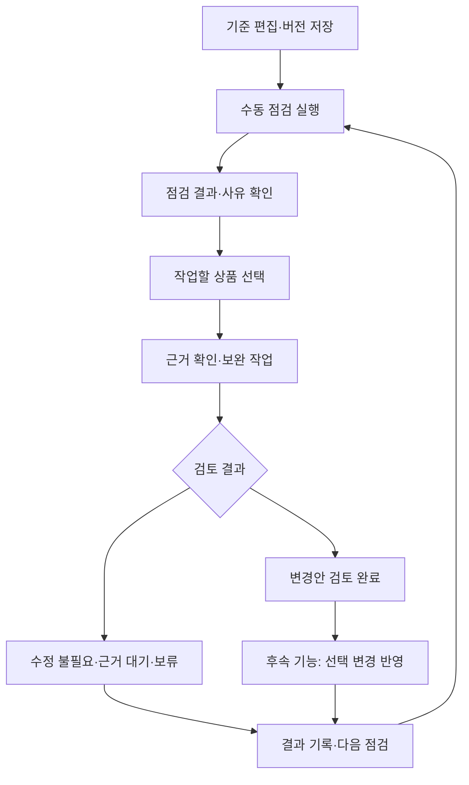

# O4O 관리자 정기 상품 관리 기획안 V1

> **상태**: DRAFT — 검토용 기획안. 신규 기능·권한·DB 변경의 확정 또는 운영 반영을 의미하지 않는다.
> **작성일·조사 확인일**: 2026-10-24
> **목적**: 관리자가 기준을 보완하면서 정기적으로 상품을 점검하고, 선택한 상품의 보완 작업을 이어가는 운영 환경을 정의한다.
> **후속 구현**: P1 수동 정기 운영의 페이지 단위 구현·검증은 [실행 TODO](../../work-orders/TODO-O4O-PRODUCT-MANAGEMENT-MANUAL-OPERATIONS-V1.md)와 [운영 안내](O4O-ADMIN-PRODUCT-CORRECTION-WORKSPACE-V1.md)를 따른다. 아래 조사 당시 상태와 구분한다.
> **범위**: 관리 항목표 · 업무 흐름 · 기준 편집 항목 · 작업 결과와 반영 규칙 · 화면별 기능표.
> **조사 범위**: O4O 내부 문서·현재 checkout의 코드와 외부 공개 개발 커뮤니티·소스. 내부 별도 커뮤니티 게시판의 비공개 자료는 조사하지 않았다.

## 1. 방향과 기존 방침

상품 관리는 **기준 관리 → 점검 → 대상 확인 → 상품 선택 → 근거 확인·보완 → 결과 기록 → 다음 점검**의 반복 업무로 구성한다. 발견 사례는 관리 기준을 발전시키는 자료로 사용한다. 사례를 발견한 즉시 현재 상품을 수정하거나 일괄 보정하는 작업으로 전환하지 않는다.

기존 [보정 작업 공간 V1](O4O-ADMIN-PRODUCT-CORRECTION-WORKSPACE-V1.md)을 출발점으로 사용한다. 현재 제공되는 수동 점검·상품 선택·초안 기록을 정기 운영에 필요한 실행 이력·점검 결과·다음 점검과 연결하는 것이 우선이다. 별도 PIM 제품으로의 교체를 선행 조건으로 삼지 않는다.

유지할 원칙:

- 상품의 식별 기준은 기존 ProductMaster UUID다. 상품 기준정보, 공용 설명 자산, 매장별 제작물을 구분한다. ProductMaster에 설명·작업 기록을 역참조하는 FK를 추가하지 않는다.
- 공통 상품 관리 권한은 기존 `platform:super_admin` 계약을 따른다. 서비스 운영자나 공급자의 원천 제출·검수 요청 경로는 해당 업무공간에 유지한다.
- 상품 사실과 전문 참고정보의 근거를 구분한다. 전문인용·AI 판단지원용·소비자 QR용은 이용 목적이며, 기존 설명서 유형·언어와 별개의 축이다.
- 질병명·진단·감별 정보는 단어만으로 배제하지 않는다. 전문 근거와 이용 맥락에 따라 검토한다. 획일적인 상담·면책 문구로 필요한 설명을 대체하지 않는다.
- 기존 QR 설명서의 공식 지식 기반 채택은 계속 판정 보류다. 새 기획으로 자동 승격하지 않는다.
- 가격·재고·주문·공급 조건은 사업 운영 영역에 유지한다. 상품 보정 작업이 매장·공급자·주문·제작물에 연쇄 쓰기를 수행하지 않는다. 다만 공용 정본을 실제 변경하면 이를 읽는 화면의 표시가 바뀔 수 있으므로 최종 반영 시 확인한다.

이 문서는 신규 운영 기능의 제안이다. 기존 구조·권한 정본을 대체하지 않으며, 아래 후속 단계의 구현·migration·운영 실행은 별도 작업 범위로 구체화한다.

## 2. 조사 근거: 외부 사례 / 현재 구현 / 권장 보완

### 2.1 외부 공개 사례

외부 이슈는 제안 또는 사용자 신고다. 커뮤니티 합의나 현재 제품 전체의 보장된 동작으로 일반화하지 않는다. 아래 링크의 본문을 확인했으며 O4O 채택 판단은 별도로 적었다.

| 외부 근거 | 확인 내용 | O4O 채택안 |
|---|---|---|
| [OpenRefine #3139](https://github.com/OpenRefine/OpenRefine/issues/3139) — 후보별 판단 특징 노출 제안 | 종합 점수 외에 후보를 비교할 수 있는 세부 판단 정보를 제공하자는 논의 | 상품별 점검 사유·관련 값·필요 근거를 표시한다. 단일 품질 점수만으로 오류나 우선순위를 확정하지 않는다. |
| [OpenRefine #2229](https://github.com/OpenRefine/OpenRefine/issues/2229) — 불안정한 연결에서 점검 지속 | 배치 요청 실패로 장시간 작업의 결과를 잃지 않아야 한다는 문제 제기 | 실행·상품별 진행 결과를 저장하고 실패 항목만 재시도한다. 기술적 실패를 정상 판정으로 기록하지 않는다. |
| [Akeneo #14185](https://github.com/akeneo/pim-community-dev/issues/14185) — 정기 품질 작업 실행 오류 신고 | 예약 명령을 실행했으나 해당 작업을 찾지 못하는 사례 | 주기 저장, 예약 등록, 실제 실행, 완료를 구분한다. 최근 성공·실패와 누락 실행을 보여준다. |
| [Directus #28374](https://github.com/directus/directus/issues/28374) — 동시 초안 편집 덮어쓰기 신고 | 오래된 화면의 자동 저장이 다른 편집 내용을 덮어쓴다는 신고 | 초안 저장에도 revision 충돌 검사를 유지하고 입력을 보존한다. 마지막 저장 우선 정책으로 처리하지 않는다. |
| [Directus versions 서비스](https://github.com/directus/directus/blob/main/api/src/services/versions.ts) — 이전 조사에서 코드 확인 | `promote`에서 `mainHash`와 현재 원본을 비교하는 경로 확인 | 초안의 동시 편집 검사와 공식 반영 직전 원본 검사를 각각 수행한다. |

일부 외부 공식 문서 사이트는 네트워크 제한으로 열람하지 못했다. 접근 가능한 GitHub 공개 이슈·소스를 근거로 사용했으며 외부 제품을 설치하거나 O4O 데이터를 전송하지 않았다.

### 2.2 O4O 내부 확인 결과

아래의 “현재”는 조사한 checkout 기준이다. main 포함·운영 배포 여부와 별개이며, 이전 작업의 보정 공간은 개발 브랜치에 구현된 상태로 본다.

| 영역 | 현재 구현 근거 | 권장 보완 |
|---|---|---|
| 진입·현황 | [탭 구성](../../../apps/admin-dashboard/src/pages/o4o-product-db/ProductDbLayout.tsx), [현황 집계](../../../apps/admin-dashboard/src/pages/o4o-product-db/ProductDbOverviewPage.tsx) | 기존 화면을 재사용한다. 점검 예정·미처리·근거 대기·최근 실행을 관리 현황에 추가한다. |
| 상품 기본정보 | [catalog 서비스](../../../apps/api-server/src/modules/neture/services/catalog.service.ts)의 수정 whitelist·immutable guard | 일반 편집과 공식 원천 정정을 구분한다. 기존 별도 수정 경로의 권한·이력도 구현 전에 확인한다. |
| 설명서 | [설명서 controller](../../../apps/api-server/src/modules/neture/controllers/product-master-description.controller.ts)에서 저장 시 `createCandidate → setCanonical` | 보완 초안 저장을 이 API에 직접 연결하지 않는다. 최종 반영 단계에서만 정본 변경 경로를 다룬다. |
| 이미지 | [이미지 controller](../../../apps/api-server/src/modules/neture/controllers/product-master-image.controller.ts)의 추가·대표 지정·숨김·복원 | 기존 기능을 재사용하고 점검 사유·출처 확인을 연결한다. |
| 관리 기록 | [감사 이력 서비스](../../../apps/api-server/src/modules/neture/services/product-master-audit-log.service.ts)에서 메모·설명 지정·이미지 이력을 집계하고 gaps를 반환 | 점검·보완·반영 기록을 상품 이력과 연결하되 기존 gaps를 완료된 것으로 표시하지 않는다. |
| 보정 기준·작업 | [현재 계약](../../../packages/types/src/product-correction.ts), [workspace 서비스](../../../apps/api-server/src/modules/neture/product-correction/workspace.service.ts) | 기준 버전·원문 snapshot·저장 충돌 검사를 재사용한다. 점검 실행과 정상 확인 결과를 추가한다. |
| 대상 찾기 | [preview](../../../apps/api-server/src/modules/neture/product-correction/preview.ts)는 ACTIVE 상품의 고정 조건 조회 | 초기에는 현재 조건을 유지한다. 중단·보관 상품 점검은 명시적 범위 선택을 지원하는 후속 기능으로 둔다. |
| 정기 실행 | [화면](../../../apps/admin-dashboard/src/pages/o4o-product-db/ProductCorrectionWorkspace.tsx)은 주기를 계획용으로 안내하며 자동 실행하지 않음 | 수동 운영을 완성한 뒤 예약 실행을 연결한다. 기존 [예약 작업 사례](../../../apps/api-server/src/jobs/community-news.job.ts)를 참고하되 다중 인스턴스 중복 방지는 별도 검증한다. |

## 3. 상품 관리 항목표

| 관리 영역 | 확인 항목 | 필요한 근거 | 처리 방향 |
|---|---|---|---|
| 상품 정체성·공식정보 | 공식명·제조사·규제 유형·허가번호·식별자와 출처 | 공식 원문, 실제 포장·바코드 등 항목에 적합한 자료 | 불일치·누락을 기록한다. 보호 필드는 일반 수정으로 덮어쓰지 않고 원천 정정 검토로 보낸다. 바코드가 없는 상품을 자동 오류로 보지 않는다. |
| 표시·분류 정보 | 상품명·브랜드·분류·규격·원산지·태그 | 해당 상품 자료와 분류 기준 | 허용된 필드별 변경안을 작성한다. |
| 수치·용량·포장 | 수치·단위·함량 기준량·권장 사용량·개수·총량의 관계 | 각 수치와 기준을 직접 연결할 수 있는 상품 원문 | 서로 비교 가능한 값인지 먼저 확인한다. 단위·기준량이 불명확하면 계산으로 보정하지 않고 근거 대기로 처리한다. |
| 상품 고유 설명 | 제품 고유 사용법·효능·특징·주의·금기 | 상품 고유 원문, 허가·표시 자료 | 일반 지식을 제품의 확정 사실로 바꾸지 않는다. 필요한 항목과 변경안을 기록한다. |
| 전문 참고정보 | 질환·진단·감별·선택 판단·상호작용·상담 판단 근거 | 출처·판본·확인일이 식별되는 전문 자료 | 상품 사실과 구분하고 적용 맥락을 설명한다. 전문 용어의 존재만으로 반려하지 않는다. |
| 목적별 구성 | 전문인용·AI 판단지원용·소비자 QR용에서 정보의 깊이와 표현 | 이용 목적, 상품 사실·전문 자료 | 목적에 맞는 설명을 만든다. STORE 복사만으로 B2B 완성 판정을 하지 않는다. |
| 이미지·첨부 | 제품 일치·가독성·대표 적합성·자료 출처·최신성 | 원본 이미지, 제공자·이용 근거·확인일 | 기존 추가·대표 지정·숨김·복원 기능을 활용한다. |
| 상품 이용 상태 | 정상·중단·보관 상태와 변경 사유 | 공식 상태 변화 또는 관리자 판단 근거 | 보완 상태와 독립적으로 관리한다. 점검 발견만으로 자동 중단하지 않는다. |
| 신규·변경 유입 | 공공데이터·공급자·매장 요청의 신규 자료와 기존 값 차이 | 출처와 원문 snapshot | 기존 후보·등록 요청 흐름을 활용한다. 동일 상품을 무조건 새 master로 생성하거나 자동 병합하지 않는다. |

예전 비타민D·유산균·화장품·의약품 사례는 위 기준의 검토 예시다. 현재 상품에 수정 결론을 부여한 목록이 아니다.

## 4. 관리자 업무 흐름

1. 관리자는 기준의 대상 범위·찾기 조건·판단 지침·근거 요건을 정하고 저장한다.
2. 점검은 기준 버전과 대상 범위를 고정해 실행한다. 실행 시각·범위·진행·성공·실패를 기록한다.
3. 후보에는 관련 값과 점검 사유를 표시한다. 점검에서 검출된 후보와 관리자가 실제로 작업 대상으로 선택한 상품을 구분한다.
4. 선택 상품에 작업 묶음을 만든다. 해당 기준 버전과 원문을 보존하고 상품별로 근거와 보완안을 기록한다.
5. 변경할 필요가 없으면 확인 근거를 남기고 종료한다. 자료가 부족하면 근거 대기, 나중에 처리하면 보류 사유와 재확인 시점을 기록한다.
6. 변경이 필요하면 변경 항목·전후 값·근거를 검토한다. 초안 저장·검토 완료·실제 반영을 구분한다.
7. 처리 결과에 따라 다음 점검 예정일을 계산한다. 작업 묶음 생성만으로 점검 완료나 다음 주기 시작으로 보지 않는다.

### 4.1 정기 운영 제안

- 초기에는 관리자가 주기적으로 화면에 들어와 직접 점검한다. 상품군별 주기는 관리자 설정이며 특정 일수를 모든 상품에 일괄 고정하지 않는다.
- 다음 점검의 기준일은 해당 상품·기준 범위의 최근 **검토 완료일**을 기본으로 제안한다. 설명서 수정일과 관리자가 검토한 날은 다른 값으로 저장한다.
- 근거 대기·보류는 정기 주기와 별도로 재확인 예정일을 둔다. 자료 대기는 완료율을 높이기 위한 정상 완료로 바꾸지 않는다.
- 동일 상품·기준 버전·유형·언어·목적·원문이 같고 미완료 작업이 있으면 그 작업으로 연결한다. 새 실행 기록은 남기되 같은 작업을 계속 중복 생성하지 않는다.
- 검토 완료한 동일 원문은 다음 예정일까지 중복 검토를 줄인다. 기준 버전·원문·원천자료가 달라지면 재점검 후보로 표시한다. 과거 판단이나 기록을 덮어쓰지 않는다.
- 기준 수정 시 기존 작업은 당시 버전을 유지한다. 관리자가 새 기준으로 다시 점검하거나 작업을 재개할지 선택한다.
- 초기화·일괄 보정·자동 이용 중단은 정기 점검에 포함하지 않는다. 예약 실행 단계에서도 자동 수행 범위는 점검과 후보 생성까지다.

## 5. 관리 기준 편집 항목

| 구분 | 편집 항목 | 현재 / 제안 |
|---|---|---|
| 식별 | 기준 이름·설명·사용 여부 | 이름·지침·사용 여부는 현재 지원 |
| 대상 | 상품군·상품 상태·유형·언어·이용 목적 | 상태 선택을 제외한 주요 축은 현재 지원. 중단·보관 포함은 후속 확장 |
| 찾기 조건 | 누락·경과일·확인 문구·동일 본문·수동 범위 | 현재 고정 연산자를 재사용. 복합 조건·원천자료 변경은 후속 |
| 판단 지침 | 어떤 자료를 보고 무엇을 확인할지, 정상·보완·근거 대기의 예시 | 현재 자유 지침을 유지하고 작성 안내를 보강 |
| 근거 요건 | 상품 사실 근거·전문 참고 근거 각각의 출처·확인일·적용 범위 | 현재 메모 입력을 항목별로 구조화하는 안 |
| 운영 | 점검 주기·중요도·일시 중지·재확인 조건 | 주기·사용 여부는 현재 지원. 중요도·재확인 조건은 후속 |
| 버전 | 버전·작성자·변경일·변경 사유·이전 기준 비교 | 버전 보존은 현재 지원. 변경 사유·비교 화면은 후속 |

찾기 조건과 판단 지침은 분리한다. 예를 들어 `mg` 포함은 검색 조건이고, “함량의 기준량이 원문에서 확인되는가”는 판단 지침이다. 자연어 지침을 저장했다고 SQL 조건이나 확정 오류 검수가 자동 생성된 것으로 표시하지 않는다.

수정 가능한 검토 기준과 시스템 권한·원본 보호 규칙도 구분한다. 관리자가 지침을 바꿔 보호 필드를 일반 편집하거나 초안 저장으로 정본을 반영할 수 있게 하지 않는다.

### 5.1 기준 작성 예시 — 수치와 기준량

- **대상**: 관리자가 선택한 상품군·유형·언어·목적.
- **찾기**: 함량 관련 문구를 포함한 상품 또는 관리자가 지정한 상품.
- **판단 지침**: 수치·단위·기준량·섭취량의 관계를 원문에서 확인한다. 포장 단위가 다른 값을 직접 합산하지 않는다.
- **필요 근거**: 각 수치가 등장한 원문 위치와 출처·확인일.
- **결과 예시**: 원문에서 관계를 확인하면 수정 불필요, 설명이 잘못 연결된 근거가 있으면 변경안 작성, 연결 근거가 없으면 근거 대기.

## 6. 작업 결과와 반영 규칙

### 6.1 서로 다른 상태를 분리

| 상태 축 | 의미·제안 값 | 현재와의 관계 |
|---|---|---|
| 상품 이용 상태 | 정상·이용 중단·보관 | 기존 ACTIVE/SUSPENDED/ARCHIVED 유지 |
| 점검 실행 상태 | 대기·실행 중·완료·일부 실패·실패·중단 | 신규 제안. 실행 완료는 상품 보완 완료가 아님 |
| 개별 점검 판단 | 조건 해당 없음·검토 필요·판정 불가 | 신규 제안. 문구 매칭 결과는 검토 필요 후보이며 오류 확정이 아님 |
| 보완 작업 진행 | 대기·작업 중·근거 대기·검토 대기·보류 | 현재 작업 상태 재사용. 종료 결과를 후속 연결 |
| 검토 종료 결과 | 수정 불필요·변경안 검토 완료·대상 제외 | 신규 제안. 대상 제외는 상품 삭제가 아닌 해당 기준의 적용 제외이며 사유 필요 |
| 원본 반영 결과 | 미반영·반영 성공·실패·원본 변경으로 재검토 | 후속 반영 기능에서만 사용. 검토 완료와 분리 |

“조건 해당 없음”은 해당 연산자의 결과일 뿐 전체 상품이 정상이라는 인증이 아니다. 판정 불가·점검 실패를 조건 해당 없음으로 처리하지 않는다. 보류는 종료 결과가 아니며 사유와 재확인 시점을 유지한다.

### 6.2 초안·근거 기록

- 상품별 작업은 기존 원문, 보완 초안, 검토 메모, 상품 사실 근거, 전문 참고 근거를 구분한다.
- 근거에는 출처, 자료명·판본 또는 식별값, 확인일, 해당 항목과 원문 위치를 기록한다. 별도 검수 상태는 검토자의 확인이며 공식 반영 완료를 뜻하지 않는다.
- 판단에는 사용한 기준 버전·원문 fingerprint·검토자·검토일·결과를 연결한다. 일부만 검토했다면 전체 상품을 검토 완료로 표시하지 않는다.
- 초안 저장 시 다른 관리자 저장과 충돌하면 입력을 유지하고 비교·재저장으로 안내한다. 이전 저장 이력도 후속 운영 모델에서 보존한다.
- 긴 원문을 잘라 표시한 경우 전체 확인 필요 표시를 유지한다. 생략된 부분을 확인한 것으로 기록하지 않는다.

### 6.3 원본 반영 — 후속 기능의 요구사항

이번 기획 작성으로 반영 기능을 개발하거나 기존 상품에 적용하지 않는다. 향후 구현 요구사항은 다음과 같다.

1. 변경안을 기본정보·설명·이미지·이용 상태별로 구분하고 관리자가 적용할 항목을 선택한다.
2. 반영 직전 현재 원본과 작업 기준 원본을 비교한다. 값이 바뀌면 자동 덮어쓰기 대신 재검토한다. 초안 revision 검사만으로 원본 충돌 검사를 대체하지 않는다.
3. 서버에서 항목별 수정 권한·허용 필드·자료 검증을 다시 수행한다. 보호된 공식정보 정정은 별도 경로 확정 전 일반 반영 대상에서 제외한다.
4. 설명서는 해당 상품·유형·언어의 기존 canonical 계약을 유지한다. 이용 목적을 새 설명서 유형으로 임의 매핑하지 않는다. AI가 활용할 구조화 근거의 저장·조회 계약은 별도 상세 설계로 확정한다.
5. 실제 변경과 변경 전후 값·근거·행위자·시각의 이력을 연결해 저장한다. 부분 실패가 있으면 어떤 항목이 반영됐는지 보여주고 성공 항목을 재적용하지 않는다.
6. 잘못된 반영의 복구는 현재 원본과 충돌을 확인한 새로운 변경 작업으로 기록한다. 보호 규칙을 우회하는 DB 원복을 일반 기능으로 제공하지 않는다.
7. 작성·검토·반영 단계는 구분하되 서로 다른 사람이 수행해야 하는 의무나 새로운 역할은 이번 기획에서 신설하지 않는다.

## 7. 화면별 기능표

새 탭 여섯 개를 한꺼번에 만드는 대신 기존 화면에 필요한 흐름을 연결한다. 아래는 업무상 화면 역할이며 최종 메뉴 이름·배치는 구현 전에 정한다.

| 화면 역할 | 기존 기반 | 보여줄 내용 | 주요 동작 |
|---|---|---|---|
| 관리 현황 | 현황 탭 | 점검 예정·기한 경과·미처리·근거 대기·반영 대기, 최근 실행 성공·실패 | 해당 기준·목록·작업으로 이동 |
| 상품 목록·상세 | 기본 상품 탭·상세 | 현재 기준정보·설명·이미지, 해당 상품의 열린 작업·최근 확인·관련 근거 | 상품에서 작업으로 이동, 기존 개별 관리 기능 사용 |
| 기준 관리 | 데이터 정비의 기준 편집 | 기준 목록·버전·대상·지침·주기·사용 여부 | 저장·이전 버전 비교·대상 미리보기 |
| 점검 실행·결과 | 데이터 정비의 대상 점검 | 실행 범위·버전·시각·진행·결과·사유·실패 | 수동 실행·실패 재시도·대상 선택 |
| 보완 작업 | 데이터 정비의 선택 작업·이력 | 상품별 원문·보완안·근거·결과·재확인 예정 | 저장·수정 불필요로 종료·근거 대기·보류·검토 완료 |
| 반영 검토 | 후속 화면 | 항목별 변경 전후·근거·현재 원본과 충돌·반영 결과 | 선택 반영·재검토·실패 확인 |
| 작업 이력 | 상품 이력 + 보정 작업 이력 | 실행→선택→검토→반영의 연결, 작성자·시각·기준 버전 | 조건 검색·상품별 보기·과거 작업 열기 |

관리 현황의 건수는 상품 수와 발견 사항 수를 구분한다. 동일 상품이 여러 기준에 걸리면 발견 사항은 여러 건일 수 있다. 완료율은 정해진 실행 범위 안의 검토 대상과 결과를 기준으로 계산하고, 선택하지 않은 상품을 정상 처리하지 않는다. 예약 기능이 없는 단계에서는 예약 상태나 자동 실행 성공을 표시하지 않는다.

## 8. 구현 구조와 AI 지원 방향

### 8.1 저장·실행 구조

- 기존 기준 버전·작업 snapshot·원본 fingerprint·revision 충돌 검사를 활용한다.
- 소량 기준 설정의 `settings` 저장은 초기 단계에서 재사용할 수 있다. 현재 작업 묶음 전체 JSON은 단일 묶음 revision으로 저장되므로 상품별 대량 조회·통계·독립 동시 편집의 장기 구조로 고정하지 않는다.
- 실행, 상품별 발견 사항, 개별 작업 결과, 근거 연결, 변경 이력은 개별 조회 가능한 운영 모델을 권장한다. 논리 모델을 먼저 정하고 전용 저장소 필요성과 이행 방식을 구현 단계에서 확정한다. 이 문서는 DDL·migration 지시가 아니다.
- 신규 기록은 상품을 참조한다. 공용 설명의 별도 정본 복제·이관이나 ProductMaster의 자산 역참조 추가로 해결하지 않는다.
- 대량 점검은 안정된 범위와 진행 지점을 저장해 나누어 실행한다. 단순 페이지 순회 중 데이터 변경으로 누락·중복되지 않도록 범위 고정 또는 cursor 기준을 정의한다.
- 예약 실행은 후속 단계다. 기준·예정 회차별 중복 실행 방지, 장애 후 재개, 재시도 한도, 시간대, 마지막 성공과 다음 예정 시각을 설계한다. 제안 시간대는 관리자에게 표시한 한국시간이며 확정 값은 설정으로 관리한다.
- 기준 저장·수동 점검·예약 후보 생성은 원본 쓰기와 연결하지 않는다. 실행 중 기준이 바뀌어도 실행 snapshot을 몰래 바꾸지 않는다.

### 8.2 AI가 수행할 일

관리자가 선택한 상품과 자료를 대상으로 상품 사실 추출, 수치·기준량의 연결 확인 보조, 전문 참고정보 정리, 이용 목적별 보완안 작성을 지원한다. 입력은 상품 원문과 전문 자료를 구분하고 출처·확인 상태를 함께 전달한다.

AI 출력은 제안 값·관련 원문 위치·근거·확인 불가 항목을 구분한다. 근거 없는 확정 수치나 제품 효능을 생성하지 않으며 전문 정보의 필요성을 일괄 회피하지 않는다. 초안은 검토 가능한 작업 기록으로 저장한다. AI 응답을 공식 상품 데이터에 바로 쓰지 않는다.

외부 호출은 후속 기능이며 사용 모델·프롬프트/기준 버전·실행 결과·비용 한도를 추적한다. 기존 외부 AI 호출 없는 수동 점검을 유료 AI 전수 실행으로 자동 전환하지 않는다.

## 9. 단계별 실행안과 완료 기준

| 단계 | 범위 | 완료 판단 |
|---|---|---|
| P0 — 이번 기획 | 관리 항목·흐름·기준·결과·화면·구현 순서 정리 | 현재 구현과 제안을 구분하고 근거를 연결한 검토용 문서 제공 |
| P1 — 수동 정기 운영 | 점검 실행 이력, 상품별 판단·종료 결과, 재확인일·다음 점검일, 열린 작업 재사용, 현황 연결 | 기준 편집→수동 실행→상품 선택→수정 불필요/근거 대기/검토 완료→재개·다음 점검 확인이 가능. 원본 mutation 없음 |
| P2 — 변경안 검토·반영 | 항목별 전후 비교·권한 재검사·원본 충돌 검사·반영 이력 | 선택한 변경만 적용하고 충돌·부분 실패·이력 기록을 검증. 보호 필드 정정은 별도 확정 경로만 사용 |
| P3 — 예약 점검 | 기준 주기별 후보 생성, 실행 중복 방지·중단·재시도·장애 표시 | 예약 회차별 실제 실행을 확인하고 실패 후 재개 가능. 자동 상품 수정 없음 |
| P4 — AI 지원 확장 | 분리 근거 입력, 근거 연결·보완안 제안, 호출 결과·비용 기록 | 제안과 확정 사실을 구분하며 관리자 검토·선택을 유지 |

우선 개발 대상으로 권장하는 것은 **P1 수동 정기 운영**이다. 기존 기능을 이용해 실제 관리 절차가 완주하는지 먼저 확인하고 반영·예약·AI 실행을 순서대로 붙인다. P1 자체를 상품 데이터 보정 실행으로 해석하지 않는다.

P1 검증 시나리오:

1. 기준 v1로 상품을 선택한 뒤 기준을 v2로 바꿔도 이전 작업은 v1·이전 원문을 유지한다.
2. 동일 원문에 열린 작업이 있는 상태에서 재점검하면 중복 작업 대신 기존 작업으로 연결된다.
3. 수정 불필요 판단은 근거와 검토 완료일을 남기며 이후 예정일을 확인할 수 있다.
4. 근거 대기·보류는 정기 완료로 처리되지 않고 재확인 일정에 나타난다.
5. 조회·실행 실패를 정상·대상 없음으로 표시하지 않고 실패 범위만 재시도할 수 있다.
6. 같은 작업의 동시 저장은 조용히 덮어쓰지 않고 작성 내용을 보존한다.
7. 기존 권한 밖에서는 조회·저장이 차단되고, 모든 P1 작업 후 기존 상품·설명·이미지·이용 상태는 동일하다.

## 10. 후속 상세 설계에서 확정할 사항

| 항목 | 권장안 | 확정이 필요한 범위 |
|---|---|---|
| 최초 운영 범위 | 현재 ACTIVE 상품·기존 조건을 우선 활용 | 첫 상품군과 시작 기준, 처리량 |
| 점검 완료·다음 예정 | 상품·기준 범위별 검토 완료일부터 계산 | 주기 변경·기준 변경 시 재점검 정책의 UI 상세 |
| 근거 등록 | 출처·확인일·대상 항목·상품 사실/전문 자료 구분 | 파일 보관 여부·허용 출처·자료 버전·자료별 권리 처리 |
| 보호 필드 정정 | 일반 보정과 분리 | 검증·승인·이력과 정정 API의 별도 작업 범위 |
| AI 활용 설명 구조 | 기존 유형·언어·자산 경계 유지 | 구조화 근거와 판단지원 정보의 저장·검색 계약 |
| 보관·정리 | 실행·판단 이력의 목적을 유지하고 중복 원문을 최소화 | 개인 식별정보 최소화, 보유·정리 정책과 운영 용량 |

위 항목은 검토할 기획 선택지다. 승인된 정책이나 구현 완료로 표기하지 않는다.

## 11. 내부 원칙·선행 자료

- [상품설명서 전문 판단·AI 활용 원칙](O4O-PRODUCT-DESCRIPTION-PROFESSIONAL-USE-POLICY-V1.md)
- [관리자 보정 작업 공간 V1 — 현재 범위](O4O-ADMIN-PRODUCT-CORRECTION-WORKSPACE-V1.md)
- [역할별 업무공간](../../baseline/O4O-ROLE-WORKSPACE-ARCHITECTURE-V1.md)
- [Product Resource 구조·불변식](../../baseline/O4O-PRODUCT-RESOURCE-ARCHITECTURE-BASELINE-V1.md)
- [관리 콘솔 기본 기획 — 과거 작업 범위](../../work-orders/WO-O4O-ADMIN-O4O-PRODUCT-MANAGEMENT-BASE-CONSOLE-V1.md)
- [단순 상품 관리 조사 — 과거 조사](../../investigations/IR-O4O-ADMIN-PRODUCT-MANAGEMENT-SIMPLE-OPERATIONS-AUDIT-V1.md)

과거 조회 전용·준비중 문구는 당시 범위로 읽는다. 현행 코드에는 상태·이미지·설명 저장 기능이 있으므로 문구만 보고 전체가 조회 전용이라고 판정하지 않는다. 반대로 코드 존재만으로 운영 배포 완료를 판정하지 않는다. 이번 문서에서는 과거 기록·Frozen 본문·canonical index를 변경하지 않는다.
